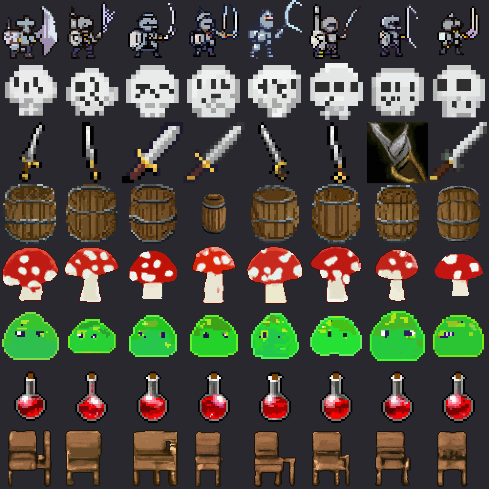

# AMBER Pixel64 v0.3

**All Made By Ethical Resources.** A small text-to-image model that draws 64×64 pixel-art sprites with transparent
backgrounds, trained from random initialisation on CC0 and public-domain pixel art only.

- No pretrained weights, no pretrained text encoder, no outside data, no AI-generated images in training.
- Training data: [AMBER Pixel64](https://github.com/DylanMartinLSC/amber-pixel64), 99,742 sprites, each with its
  licence, author and source page.
- 91.6M parameters. Runs on any CUDA GPU in a few seconds per batch, or on a CPU.



_Uncurated: the first 8 seeds for each of the 8 prompts the model was monitored with during training
(`examples/grid_prompts.json`). Rebuild it with `python make_examples.py`._

## Quick start

```bash
git clone https://github.com/DylanMartinLSC/amber-pixel64-model
cd amber-pixel64-model
pip install -r requirements.txt
```

Download `amber-pixel64-v0.3.safetensors` from the
[v0.3 release](https://github.com/DylanMartinLSC/amber-pixel64-model/releases/tag/v0.3) into `weights/`, then:

```bash
python generate.py "object, red potion bottle, round glass flask with a narrow neck and a brown cork stopper"
```

This writes 8 transparent 64×64 PNGs and an enlarged preview sheet to `sprites/`. Useful options: `--count 16`,
`--seed 7`, `--palette pico8` (or `1bit`, or `ff0000,00ff00,...`), `--colours 8`, `--device cpu`.

From Python:

```python
from amber_pixel import AmberPixel

amber = AmberPixel.load()
sprites = amber.generate("plant, red mushroom with a round cap covered in white spots", count=8, seed=0)
sprites[0].save("mushroom.png")  # RGBA PIL image
```

## Writing prompts

The model learned from captions written in one style, and it does best when prompts follow it:

```
pixel art, <kind>, <what it is>, <colours and details>
```

`<kind>` is one of the words the captions used, such as `character`, `creature`, `object`, `plant`, `tile`, `icon`,
`building`. `pixel art, ` is added for you if you leave it out. Describe colours and parts plainly ("brown wooden
planks, two dark metal hoops"); short, concrete captions work better than adjectives or style words.

The vocabulary is the 10,226 words that appear in the training captions. Any other word is ignored, and
`generate.py` prints the words it did not know. Proper names and brands are not in the vocabulary on purpose.

## What is in this repository

| path | what |
|---|---|
| `weights/amber-pixel64-v0.3.safetensors` | EMA weights, fp32, 367 MB (on the Releases page; not in git) |
| `config.json` | architecture, default sampler settings, training provenance |
| `tokenizer.json` | word list built from the training captions alone |
| `amber_pixel/` | model, sampler, tokenizer and sprite post-processing (about 400 lines, PyTorch only) |
| `generate.py` | command line |
| `make_examples.py` | rebuilds `examples/grid.png` |
| `SHA256SUMS` | hashes of the weights and data files |

The weights are a plain safetensors file: no pickle, no optimizer state.

## Model

**A joint-attention diffusion transformer (MMDiT-style) trained with rectified flow.**

| part | size |
|---|---|
| image | 64×64 RGB cut into 4×4 patches → 256 tokens, learned position embeddings |
| text encoder | word-level, 10,226 words, 6-layer transformer, width 384, 48 tokens max |
| backbone | 8 joint blocks, width 512, 8 heads; image and text tokens keep separate weights but share one attention; query/key RMS norm; adaLN-zero modulation from flow time and the pooled caption |

Transparency is a colour: training sprites have magenta (`#ff00ff`) backgrounds, and the post-processing turns magenta
into alpha, snaps the rest to an adaptive (or fixed) palette, and leaves every pixel fully opaque or fully transparent.

**Sampler** (the settings the release was judged with): 100 Euler steps, classifier-free guidance 5 applied between
t = 0.2 and 0.95, and the outer 6 pixels started 1% of the way towards magenta so backgrounds stay empty.

## Training

1. **v0.3 from scratch** on the AMBER Pixel64 `train` split: batch 128, AdamW (learning rate 2e-4, weight decay 0.01),
   dropout 0.1, bf16, EMA 0.9999, 10% caption dropout. Augmentations the model cannot copy into samples: flips except
   for captions with direction words, labelled quarter turns and shifts, and colour swaps that change the colour word in
   the caption too. Error on sprites from artists the model never saw was lowest at step 190,027 and rose afterwards
   while training error kept falling (memorisation), so the run was stopped there.
2. **Wind-down**: from the step-190,027 weights, a fresh optimizer, 1 hour at full learning rate, then a cosine decay to
   10%. EMA snapshots every 3 hours were compared side by side by eye; the one at step 104,546 was picked.

About 26 hours in total on one RTX 3090.

**At the released weights** (fixed seeds, uniform flow time):

| | value |
|---|---|
| velocity error, sprites from artists never seen in training (577) | 0.0682 |
| velocity error, held-out sprites from seen artists (2,170) | 0.0779 |
| velocity error, training sprites (reference) | 0.0406 |
| caption effect in the mid-noise band (error with shuffled captions vs right ones) | +43% |
| monitoring samples closer to a training sprite than the near-copy threshold | 1 of 32 |

The one near-copy was a red potion bottle, a very common, simple shape in the data.

## Limitations

- 64×64 only. Most training sprites are smaller art enlarged on the 64 canvas, so many outputs are chunky (2× or 3×
  pixels) rather than full-resolution 64-pixel art.
- Letters and text come out as noise; faces are often mottled; hands and thin weapons can break up.
- Some samples fill their background (one of 64 in the grid above). Change the seed.
- English only, and only the training-caption vocabulary.
- Small model, small data: it can still reproduce a training sprite closely, mostly for simple, common shapes. Check
  outputs you plan to ship against the dataset if that matters to you.
- Licences in the training data are the uploaders' claims; see the
  [dataset card](https://github.com/DylanMartinLSC/amber-pixel64) for how the data was audited.

## Licence

Everything here — weights, code, tokenizer, config and example images — is dedicated to the public domain under
[CC0 1.0](LICENSE). Use it for anything, commercial or not, with no attribution required. Sprites you generate are
yours to do with as you like.

CC0 covers this repository only. It cannot vouch for the training data beyond the audit described in the dataset card,
and it is not legal advice.

## Credits

Thank you to every artist who released their pixel art to the public domain. Their names and source pages are in the
[AMBER Pixel64 dataset](https://github.com/DylanMartinLSC/amber-pixel64).

Architecture after Esser et al. 2024 (*Scaling Rectified Flow Transformers*) and Liu et al. 2022 (rectified flow).
